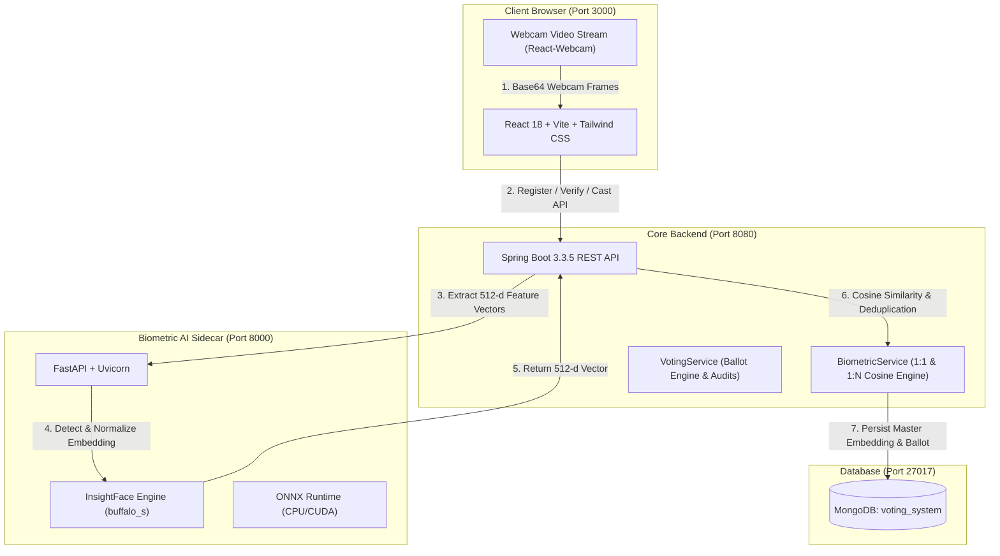

# 🗳️ BlockVote+ : AI-Powered Multi-Factor Biometric Voting System

[](https://www.oracle.com/java/)
[](https://spring.io/projects/spring-boot)
[](https://www.python.org/)
[](https://fastapi.tiangolo.com/)
[](https://github.com/deepinsight/insightface)
[](https://react.dev/)
[](https://vitejs.dev/)
[](https://www.mongodb.com/)

**BlockVote+** is a secure, next-generation electronic voting and election governance platform engineered to eliminate voter impersonation, duplicate balloting, and identity fraud. By combining deep facial biometric feature extraction (**InsightFace `buffalo_s`**), multi-frame enrollment aggregation, 1:N facial deduplication, secondary biometric verification, and strict single-vote cryptographic validation, BlockVote+ ensures verifiable and tamper-resistant democratic elections.

---

## 📑 Table of Contents

- [System Architecture](#-system-architecture)
- [Key Features](#-key-features)
- [Biometric & Algorithmic Foundation](#-biometric--algorithmic-foundation)
- [Tech Stack](#-tech-stack)
- [Project Directory Structure](#-project-directory-structure)
- [Prerequisites](#-prerequisites)
- [Installation & Setup](#-installation--setup)
- [Running the Services](#-running-the-services)
- [API Reference](#-api-reference)
- [User Walkthrough](#-user-walkthrough)
- [Admin Portal Credentials](#-admin-portal-credentials)
- [Security & Anti-Fraud Mechanisms](#-security--anti-fraud-mechanisms)
- [Troubleshooting & FAQs](#-troubleshooting--faqs)

---

## 🏛️ System Architecture

BlockVote+ operates as a decoupled, multi-tier microservice architecture:



---

## ✨ Key Features

### 1. Multi-Frame Biometric Voter Enrollment
- Captures multiple live webcam snapshots across subtle facial movements.
- Computes an aggregated mean 512-dimensional baseline vector with L2 normalization for enhanced feature stability.

### 2. 1:N Facial Deduplication (Anti-Ghost Registration)
- Before a new voter is registered, their face vector is matched against **all existing registered voters in the database**.
- If a candidate face matches an existing identity above the threshold ($0.45$), registration is rejected immediately, preventing duplicate registrations under false IDs.

### 3. Real-Time 1:1 Cosine Similarity Verification
- During voting, a fresh webcam snapshot is sent to the AI sidecar to extract a live 512-d vector.
- Vector dot-product cosine similarity against the stored baseline verifies identity within milliseconds.

### 4. Multi-Factor Biometric Balloting
- Integrates secondary biometric authentication (fingerprint verification hash) alongside facial verification to satisfy multi-factor security requirements.

### 5. Strict Single-Vote Immutability
- Double-voting is strictly prevented at the database and application levels.
- Upon voting, the voter's status is atomically updated (`hasVoted = true`), recording candidate ID and timestamp in an audit log.

### 6. Interactive Admin Command Center
- Live turnout percentages and real-time candidate tally meters.
- Election lifecycle control (Activate, Pause, Terminate elections).
- Candidate roster management (add candidates, change parties and symbols).
- Comprehensive voter audit trails.

---

## 🔬 Biometric & Algorithmic Foundation

### 1. Feature Representation
Faces are processed by InsightFace's `buffalo_s` model pack (RetinaFace detector + ArcFace recognition backbone). It outputs a 512-dimensional floating-point embedding vector:
$$\mathbf{v} \in \mathbb{R}^{512}$$

### 2. L2 Vector Normalization
To standardize vector scale and enable dot-product cosine equivalence:
$$\mathbf{v}_{\text{norm}} = \frac{\mathbf{v}}{\|\mathbf{v}\|_2} = \frac{\mathbf{v}}{\sqrt{\sum_{i=1}^{512} v_i^2}}$$

### 3. Mean Enrollment Vector
During registration, $K$ distinct frames are captured and normalized:
$$\mathbf{M} = \frac{1}{K} \sum_{k=1}^K \mathbf{v}_k, \quad \mathbf{M}_{\text{master}} = \frac{\mathbf{M}}{\|\mathbf{M}\|_2}$$

### 4. Cosine Similarity Metric
Cosine similarity between the master vector $\mathbf{A}$ and live verification vector $\mathbf{B}$ is computed as:
$$\text{Sim}(\mathbf{A}, \mathbf{B}) = \frac{\mathbf{A} \cdot \mathbf{B}}{\|\mathbf{A}\|_2 \|\mathbf{B}\|_2} = \sum_{i=1}^{512} A_i B_i$$
- **Similarity Threshold**: $\ge 0.45$ ($45.0\%+$ match) confirms the identity for `buffalo_s` embeddings.
- **Face Count Enforcement**: Rejects any frame with $0$ faces or $> 1$ faces to prevent spoofing or multi-person interference.

---

## 🛠️ Tech Stack

### AI Biometric Service (`ai-service`)
- **Language**: Python 3.10+
- **Framework**: FastAPI, Uvicorn
- **AI / Computer Vision**: InsightFace (`buffalo_s`), OpenCV (`opencv-python-headless`), ONNX Runtime, NumPy, Pydantic v2

### Core Backend (`backend`)
- **Language**: Java 21 (LTS)
- **Framework**: Spring Boot 3.3.5
- **Data & Persistence**: Spring Data MongoDB, MongoDB Driver
- **Utilities**: Project Lombok, Jakarta Bean Validation, Spring Web

### Frontend Application (`frontend`)
- **Library**: React 18
- **Language**: TypeScript 5.2
- **Build Tool**: Vite 5.4
- **Styling**: Tailwind CSS 3.4, PostCSS, Autoprefixer
- **Icons & UI**: Lucide React
- **Webcam Integration**: `react-webcam`
- **HTTP Client**: Axios

### Database
- **Engine**: MongoDB 6.0+ (Port `27017`)
- **Database Name**: `voting_system`

---

## 📂 Project Directory Structure

```plaintext
BlockVote+/
├── ai-service/                     # Python Biometric AI Sidecar
│   ├── Dockerfile                  # Containerization definition
│   ├── main.py                     # FastAPI application & InsightFace pipeline
│   └── requirements.txt            # Python dependencies
│
├── backend/                        # Spring Boot Core Backend
│   ├── pom.xml                     # Maven project configuration
│   └── src/
│       └── main/
│           ├── java/com/voting/
│           │   ├── VotingApplication.java     # Spring Boot Entry Point
│           │   ├── config/                    # CORS and Web configuration
│           │   ├── controller/                # REST Controllers (Admin, Voter, Voting)
│           │   ├── dto/                       # Request & Response Data Transfer Objects
│           │   ├── model/                     # MongoDB Entities (Voter, Candidate, Election)
│           │   ├── repository/                # Spring Data MongoDB Repositories
│           │   └── service/                   # BiometricService & VotingService
│           └── resources/
│               └── application.yml            # Ports, MongoDB URI, AI service URL
│
├── frontend/                       # Vite + React Frontend
│   ├── index.html                  # HTML entry point
│   ├── package.json                # Dependencies and npm scripts
│   ├── tailwind.config.js          # Tailwind CSS styling configuration
│   ├── tsconfig.json               # TypeScript configuration
│   ├── vite.config.ts              # Vite server configuration
│   └── src/
│       ├── App.tsx                 # Main application component & tabs
│       ├── main.tsx                # React DOM mount point
│       ├── index.css               # Global Tailwind CSS directives
│       └── components/             # UI Components
│           ├── AdminDashboard.tsx  # Admin statistics, candidate & election controls
│           ├── AdminLogin.tsx      # Admin authentication modal
│           ├── RegisterVoter.tsx   # Multi-frame voter registration
│           ├── VerifyVoter.tsx     # Biometric verification & ballot casting
│           └── VoterPortal.tsx     # Voter navigation hub
│
└── README.md                       # Complete Project Documentation
```

---

## 📋 Prerequisites

Before running the project, ensure you have the following installed:

1. **Java Development Kit (JDK)**: Java 21 or higher
   ```powershell
   java -version
   ```
2. **Apache Maven**: Version 3.8+
   ```powershell
   mvn -version
   ```
3. **Python**: Version 3.10 or 3.11
   ```powershell
   python --version
   ```
4. **Node.js**: Version 18+ and `npm`
   ```powershell
   node -v
   npm -v
   ```
5. **MongoDB Server**: Running locally on port `27017` or accessible via MongoDB Atlas
   ```powershell
   Get-Service -Name "*mongo*"
   ```

---

## 📦 Installation & Setup

### 1. Database Setup
Ensure MongoDB is running locally:
```powershell
# Windows Service check / start
Start-Service MongoDB
```

### 2. Python AI Service Dependencies
```powershell
cd ai-service
pip install -r requirements.txt
cd ..
```

### 3. Spring Boot Backend Build
```powershell
cd backend
mvn clean compile
cd ..
```

### 4. Frontend Dependencies
```powershell
cd frontend
npm install
cd ..
```

---

## 🚀 Running the Services

BlockVote+ consists of three services that should run simultaneously:

### Service 1: AI Biometric Sidecar (Port 8000)
In your first terminal:
```powershell
cd ai-service
python -m uvicorn main:app --host 127.0.0.1 --port 8000
```
- Health Probe: `http://127.0.0.1:8000/health`
- Swagger UI Docs: `http://127.0.0.1:8000/docs`

### Service 2: Spring Boot Backend (Port 8080)
In your second terminal:
```powershell
cd backend
mvn spring-boot:run
```
- API Base: `http://localhost:8080/api/v1`

### Service 3: Frontend Web Portal (Port 3000)
In your third terminal:
```powershell
cd frontend
npm run dev
```
- Web Application: `http://localhost:3000`

---

## 📡 API Reference

### Biometric AI Service (`http://localhost:8000`)

| Method | Endpoint | Description |
| :--- | :--- | :--- |
| `GET` | `/health` | Health check probe (`{"status": "UP"}`) |
| `POST` | `/extract-embedding` | Takes base64 image; returns normalized 512-d float array |

### Voter Endpoints (`http://localhost:8080/api/v1/voters`)

| Method | Endpoint | Request Body | Description |
| :--- | :--- | :--- | :--- |
| `POST` | `/register` | `{ voterId, name, frames: [...] }` | Registers voter with multi-frame embeddings & deduplication check |
| `POST` | `/verify` | `{ voterId, frame }` | 1:1 Cosine Similarity comparison against baseline |
| `GET` | `/{voterId}` | *None* | Retrieves voter profile by Voter ID |

### Voting Endpoints (`http://localhost:8080/api/v1`)

| Method | Endpoint | Request Body | Description |
| :--- | :--- | :--- | :--- |
| `GET` | `/election/active` | *None* | Retrieves the active election schedule (Start Time, End Time, Title, Status) |
| `GET` | `/candidates` | *None* | Lists all active candidates with vote tallies |
| `POST` | `/votes/cast` | `{ voterId, candidateId }` | Validates voter eligibility & election time window, recording vote atomically |

### Admin Endpoints (`http://localhost:8080/api/v1/admin`)

| Method | Endpoint | Description |
| :--- | :--- | :--- |
| `POST` | `/login` | Authenticates administrator (`admin` / `admin123`) |
| `GET` | `/stats` | Returns turnout statistics, candidate tallies, and audit logs |
| `GET` | `/elections` | Returns all elections and their scheduled start/end timestamps |
| `POST` | `/elections` | Creates a new election with `electionId`, `title`, `description`, `startTime`, and `endTime` |
| `PUT` | `/elections/{id}/status` | Updates election status (`ACTIVE`, `PAUSED`, `ENDED`) |
| `POST` | `/candidates` | Registers a new candidate for an election |
| `DELETE` | `/reset-database` | Clears and resets database with initial election seed |

---

## 🚶 User Walkthrough

### Step 1: Register a Voter
1. Open [http://localhost:3000](http://localhost:3000) in a browser with webcam access.
2. Select the **Voter Portal** tab.
3. Click **"New Voter Registration"**.
4. Enter a unique **Voter ID** (e.g., `VOTER-101`) and **Full Name**.
5. Allow camera permissions and position your face in the guide box.
6. Click **"Capture Biometric Frames"**. 3 high-resolution frames are captured.
7. Click **"Register Voter"**. The system checks for 1:N duplicate faces before saving.

### Step 2: Verify Identity & Cast Ballot
1. On the Voter Portal, click **"Cast Your Ballot"**.
2. Enter your registered **Voter ID**.
3. Align your face with the webcam and click **"Capture & Verify Face"**.
4. The system compares the live frame with the baseline vector. When similarity $\ge 45\%$, verification succeeds.
5. Confirm the secondary biometric verification (fingerprint confirmation).
6. Select your preferred candidate from the ballot list and click **"Confirm & Cast Vote"**.
7. Receive your cryptographic ballot confirmation receipt.

### Step 3: Admin Monitoring
1. Switch to the **Admin Portal** tab in the top navigation.
2. Log in using the credentials below.
3. Monitor real-time turnout metrics, candidate vote breakdown, and voter audit trails.

---

## 🔑 Admin Portal Credentials

- **Username**: `admin`
- **Password**: `admin123`
- **Role**: `SUPER_ADMIN`

*(Configured in `com.voting.service.VotingService.java`)*

---

## 🛡️ Security & Anti-Fraud Mechanisms

| Threat | Mitigation Mechanism |
| :--- | :--- |
| **Impersonation / Proxy Voting** | Real-time 1:1 Cosine Similarity matching against stored high-dimensional face embeddings. |
| **Duplicate Registrations** | 1:N Facial Deduplication search sweeps the entire voter database during registration. |
| **Multiple People on Camera** | Strict single-face validation: any frame with 0 or $>1$ faces is rejected with HTTP 400. |
| **Double Voting** | Atomic MongoDB record locking on the voter document (`hasVoted` flag set to `true`). |
| **Data Poisoning** | Vectors are generated strictly on the Python sidecar; raw biometric vectors are normalized. |

---

## ❓ Troubleshooting & FAQs

### Q1: The webcam shows a blank or black box
- Ensure your browser has permission to access the webcam (`chrome://settings/content/camera`).
- Check that another application (Zoom, Teams, etc.) is not using the camera.

### Q2: AI Service fails to extract embedding ("No face detected")
- Ensure adequate lighting and face the camera directly without obstructions (sunglasses, masks).
- Keep only one person in the camera frame.

### Q3: Port conflicts (8000, 8080, or 3000 already in use)
- You can find and terminate conflicting processes on Windows:
  ```powershell
  Get-NetTCPConnection -LocalPort 8000, 8080, 3000 -ErrorAction SilentlyContinue | Select-Object LocalPort, OwningProcess
  Stop-Process -Id <PID> -Force
  ```

### Q4: MongoDB connection refused
- Check if MongoDB service is running:
  ```powershell
  Get-Service -Name "*mongo*"
  # If stopped:
  Start-Service MongoDB
  ```

---

## 📄 License
This project is open-source and intended for academic, research, and non-partisan electoral technology evaluation.
